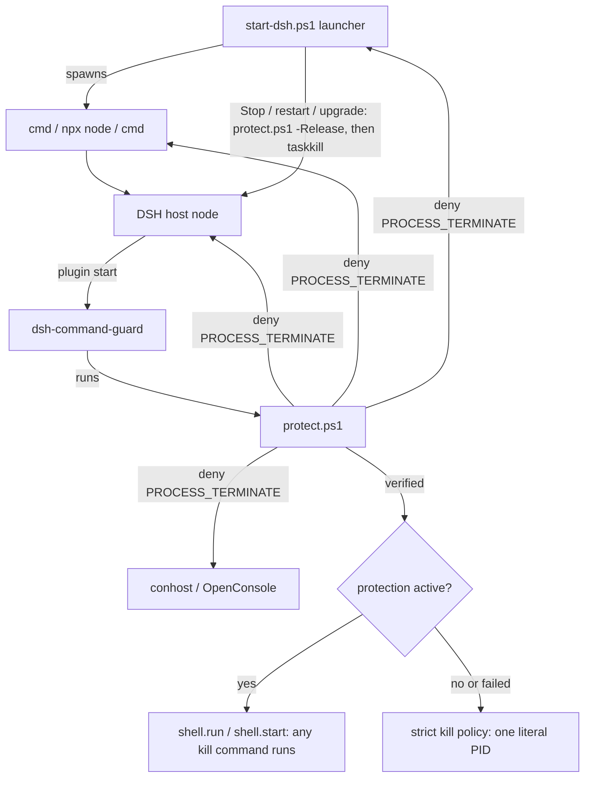

# Architecture

> System flow, auth strategy, state management, cross-cutting structure. Keep it terse: pointers into code, not essays.

## DSH kill protection

`packages/dsh-command-guard`: at DSH start, `lib/protect.ps1` denies termination of DSH, its launcher chain and their console hosts; once verified, shell commands run unchecked, else `lib/policy.js` keeps the strict kill policy. `start-dsh.ps1` `Stop-Gracefully` releases before it stops DSH.

